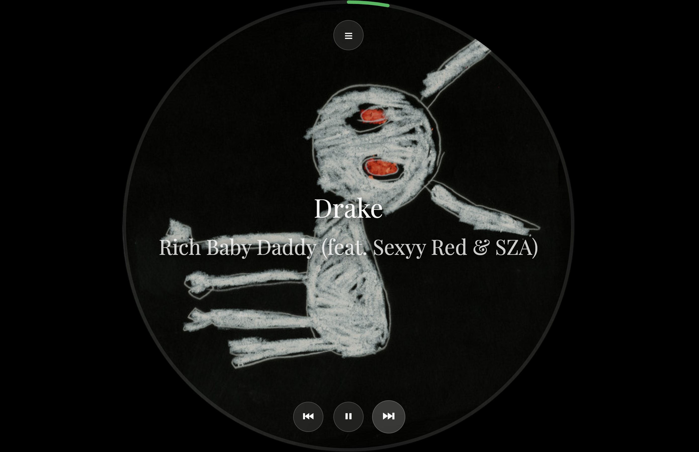
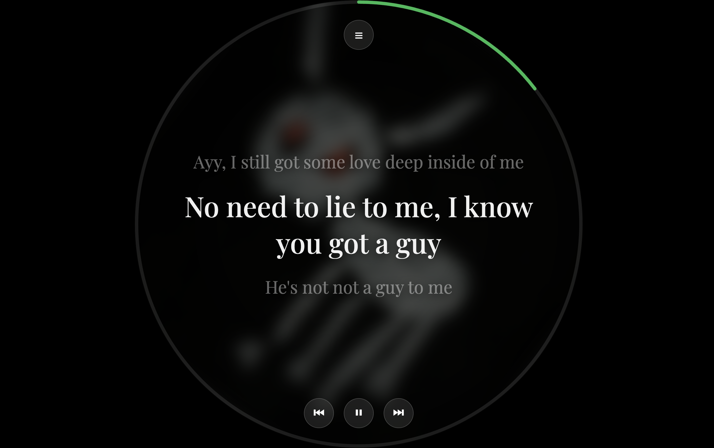

# 🎵 Digital Vinyl with Lyrics

A beautiful circular Spotify player that brings the classic vinyl experience to life with real-time synchronized lyrics. Designed for circular displays with touch controls and a stunning vinyl-style interface.

## Screenshots

### Album View


### Lyrics View  


## Features

✅ **Full Spotify Player** - Browse playlists, albums, search, and control playback  
✅ **Real-time Lyrics** - Synced word-by-word highlighting with smooth transitions  
✅ **Circular UI Design** - Optimized for circular displays with vinyl-style interface  
✅ **Playlist Support** - Play your playlists and saved albums  
✅ **Web Playback SDK** - Real-time updates without polling  
✅ **Touch Gestures** - Seek by dragging on the vinyl circle  
✅ **Free Lyrics** - LRCLib API integration (no API key needed)  

## Setup

### 1. Install dependencies
```bash
python3 -m venv .venv
source .venv/bin/activate
pip install -r requirements.txt
```

### 2. Set up Spotify API
1. Go to [Spotify Developer Dashboard](https://developer.spotify.com/dashboard)
2. Create a new app
3. Copy your Client ID and Client Secret
4. Add `http://127.0.0.1:8888/callback` as a redirect URI

### 3. Configure environment variables
Create a `.env` file:
```
SPOTIFY_CLIENT_ID=your_client_id_here
SPOTIFY_CLIENT_SECRET=your_client_secret_here
SPOTIFY_REDIRECT_URI=http://127.0.0.1:8888/callback
```

### 4. Run the app
```bash
source .venv/bin/activate
python main.py
```

The first run opens a Spotify login in your browser. After that the login is saved in `.cache`.

The server only listens on `127.0.0.1` by default. See `.env.example` for `HOST`, `PORT` and `FLASK_DEBUG`.

### 5. Open browser
Visit: http://127.0.0.1:5004

## Usage

### Basic Playback
- **Menu Button (Top)**: Access playlists, albums, search, and recently played
- **Play/Pause**: Center button at bottom
- **Previous/Next**: Left and right buttons at bottom
- **Seek**: Drag your finger around the vinyl circle to seek

### Browsing
- Click **Menu** → Select **Playlists** to browse your playlists
- Click any playlist to **play it with shuffle enabled**
- Click **Albums** to browse your saved albums
- Click **Search** to search for tracks
- Click **Recent** to see recently played tracks

## Architecture

### Backend
- **Flask** - Web framework
- **Spotipy** - Spotify Web API wrapper
- **LRCLib API** - Free synced lyrics

### Frontend
- **Spotify Web Playback SDK** - Real-time playback control
- **Vanilla JavaScript** - No frameworks, pure JS
- **Modern CSS** - Glassmorphism and vinyl-style design

### Key Components
- `main.py` - Flask application and routes
- `app/services/spotify_service.py` - Spotify API integration
- `app/services/lyrics_service.py` - Lyrics fetching
- `app/static/js/app.js` - Frontend player logic
- `app/templates/index.html` - Main UI

## API Endpoints

- `GET /api/playlists` - Get user playlists
- `GET /api/playlist/<id>/tracks` - Get playlist tracks
- `GET /api/albums` - Get saved albums
- `GET /api/search?q=<query>` - Search tracks
- `POST /api/play` - Play track/album/playlist
- `GET /lyrics?track=<name>&artist=<artist>&duration_ms=<ms>` - Get synced lyrics (duration picks the matching version)
- `GET /api/access-token` - Get Web Playback SDK token
- `POST /api/transfer-playback` - Transfer to Web SDK device

## Technical Details

- **Real-time Updates**: Web Playback SDK events + 100ms position polling for smooth lyrics
- **Lyrics Sync**: Millisecond-accurate timing with LRCLib
- **Circular Design**: Optimized for 1080x1080 circular displays

## License

MIT License - feel free to use and modify!

---

**Built with ❤️ for music lovers who want to sing along!** 🎤
